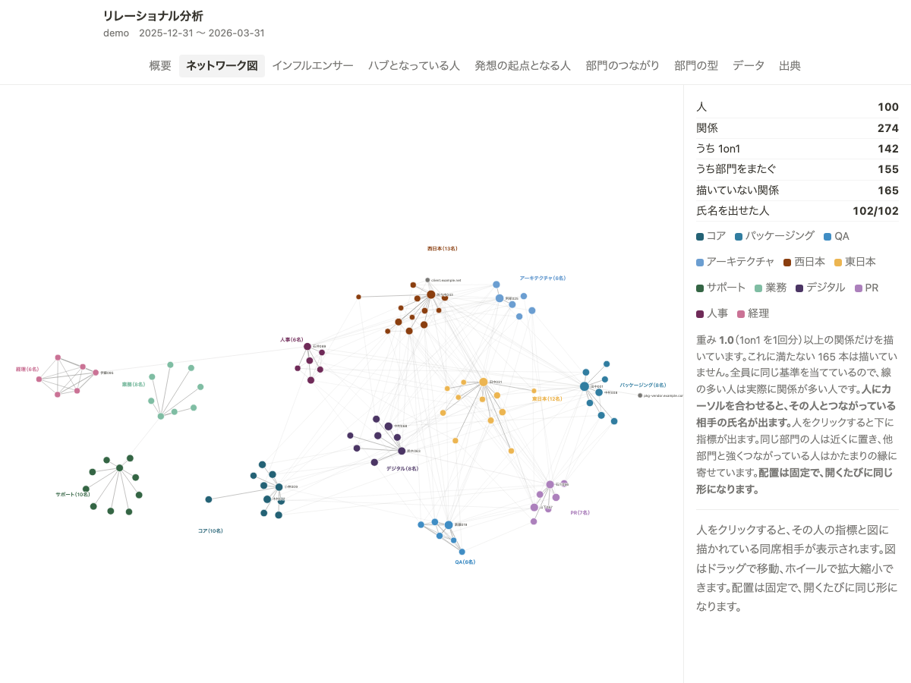
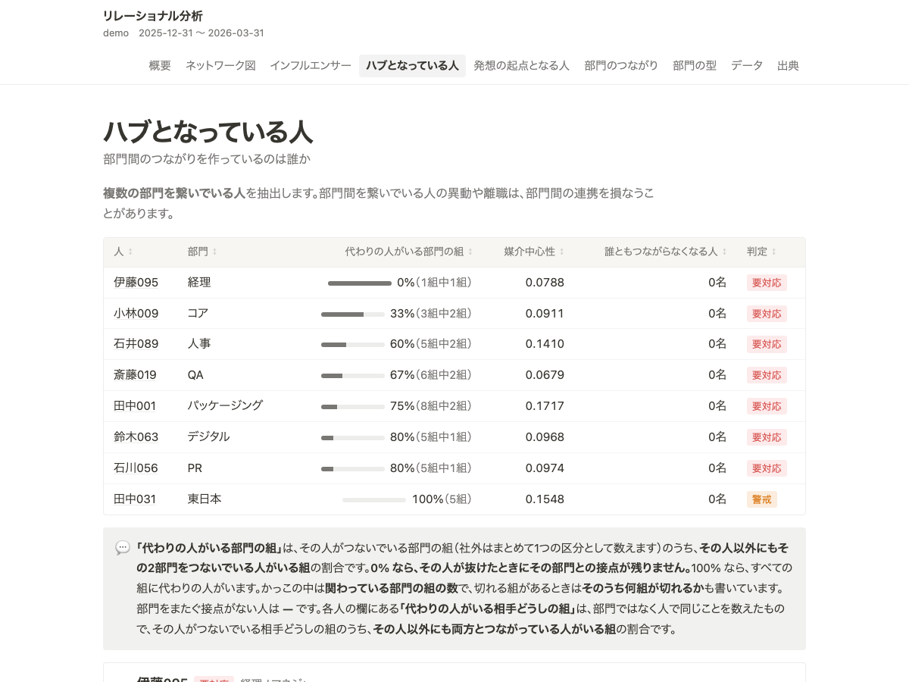
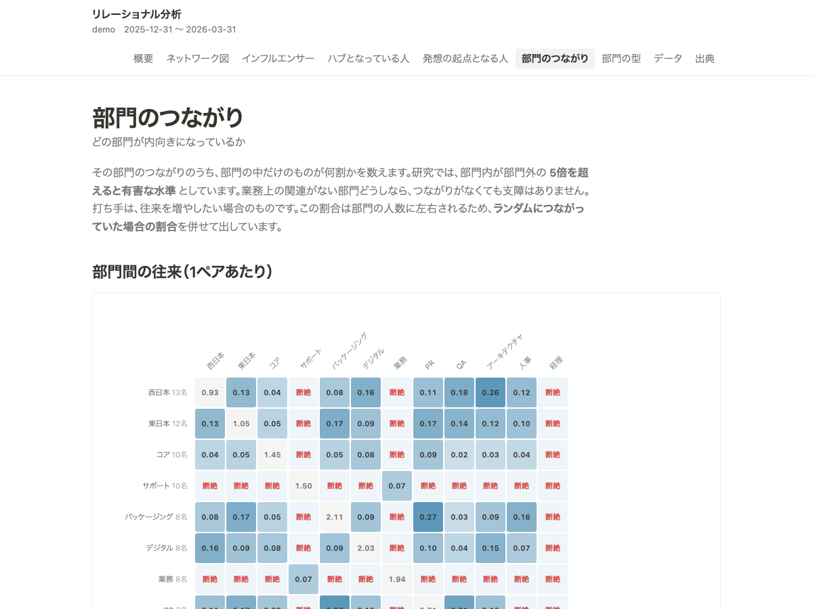
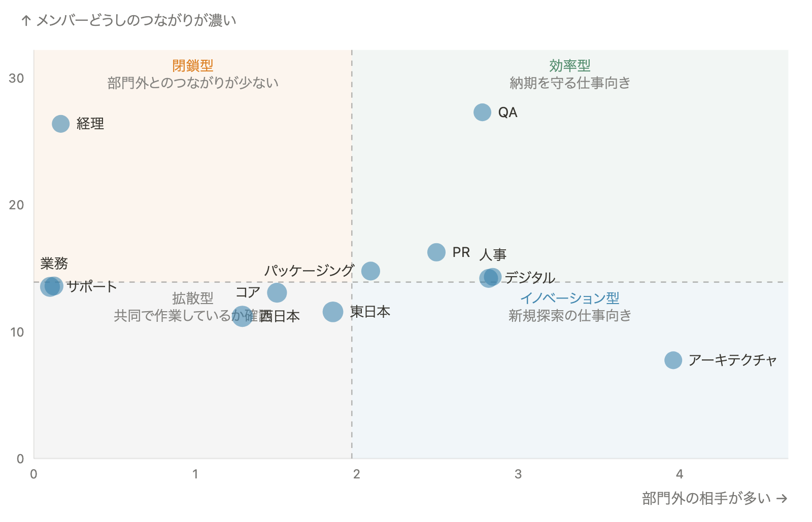

# relational-analytics — 組織のリレーショナル分析

会議の予定（カレンダー）から、誰と誰がつながっているかを集計し、組織の形を測るツールです。

経歴やスキルのような、その人ひとりを見れば分かること（属性）は使いません。
見るのは、組織の中でその人がどこにいるかです。

> **English summary** — relational-analytics turns meeting records from Google Calendar into an
> organizational network and reports five structural signals: ideation, influence, silos,
> team structure and vulnerability (single points of failure). It is designed for HR teams
> who are not engineers, so the whole workflow (setup, data collection, org-chart inference,
> interpretation) can be driven by a coding agent such as Claude Code, Codex, Gemini CLI,
> Cursor or GitHub Copilot. The report and documentation are in Japanese. MIT.

---

## この分析で可視化するもの

元になった研究は、レオナルディとコントラクターの「Better People Analytics」（Harvard Business Review、2018年。邦訳『ピープルアナリティクスで人事戦略が変わる』第5章）です。
研究が挙げる6つの構造的特徴を、5つの分析として出します。

| 分析 | 単位 | 分かること |
|---|---|---|
| 発想の起点となる人 | 人 | 新しい発想が出やすい位置にいるのは誰か |
| インフルエンサー | 人 | 少ない相手を通じて、情報が遠くまで届く位置にいるのは誰か |
| ハブとなっている人 | 人 | その人が抜けると、どの部門とどの部門の接点が切れるか |
| 部門のつながり | 部門 | どの部門が、つながりの大半を部門の中だけで持っているか |
| 部門の型 | 部門 | 納期を守る仕事に向いた形か、新しいことを探す仕事に向いた形か |

以下は、架空の100名の会社のデータで作ったレポートです。セットアップ直後に `relana demo` で同じものが見られます。

### ネットワーク図

100名のつながりを部門ごとに色分けして描きます。他の部門とつながりが少ない部門と、部門をまたいでいる人が分かります。

### ハブとなっている人

複数の部門をつないでいる人と、その人が抜けたときに接点が残らない部門の組を一覧にします。
組織図では目立たない人が出てきます。その人が異動すると複数の部門の接点が切れる、という状態を、異動の前に知ることができます。

### 部門のつながり

部門どうしの往来を数字と色の濃さで示します。継続的と言える接点が残っていない組は「断絶」と表示します。

### 部門の型

縦にメンバーどうしのつながりの濃さ、横に部門外の相手の広さを取り、部門を4つの型に分けます。
研究では、右上の型は納期を守る仕事に向き、右下の型は新しいことを探す仕事に向くとしています。

---

## 利用するデータ

Google カレンダーの予定から、次のものを使います。

| 使うもの | 用途 |
|---|---|
| 会議の参加者 | 誰と誰がつながっているかの集計 |
| 開始時刻と所要時間 | つながりの重み付け。長い会議ほど重く数えます |
| 参加人数 | つながりの重み付け。大人数の会議ほど1組あたりを軽く数えます |
| 定例のグループ会議のタイトル | チーム名と部門名の推定。「◯◯本部 マネジャー定例」のような名前から部門を読み取ります |

次のものは使いません。収集もしません。

- 1on1 と単発の会議のタイトル。個人的な内容が入りやすいためです
- 会議の本文、議題、議事録、場所、添付ファイル
- チャットとメール

主催者は記録しますが、分析には使いません。代理で設定した予定や、定例を最初に作った人が主催者のまま残るためです。

名簿と部門の一覧は要りません。定例会議の顔ぶれからチームを、1on1の相手から上司を、
課長・部長クラスが集まる定例から部門を推定します。
合成データ100名での検証では、チームの顔ぶれと上司は全員一致しました。
部門は外れることがあるので、推定結果の部門の列だけ確認して直してください。
直さずに分析することもできます。その場合、部門のつながりの結果に
「部門は推定値なので下書きとして扱ってください」という注記が付きます。

---

## 準備するもの

サンプルを見るだけなら、パソコンと Python があれば足ります。自社のカレンダーを分析するには、残りも要ります。

| 準備するもの | 内容 |
|---|---|
| パソコン | macOS、Windows、Linux のどれか。セットアップ時に部品を取得するので、インターネットにつながっている必要があります |
| Python 3.11 以上 | 入っていなければ、セットアップの画面に入れ方の案内が出ます |
| Google カレンダー | 会社で Google Workspace を使っていること。Outlook など他のカレンダーには対応していません |
| カレンダーの社内共有 | 同僚の予定の参加者まで見られる共有設定になっていること。「予定の有無のみ」の共有では参加者が取れず、分析できません。設定は Google Workspace の管理者が決めています |
| コーディングエージェント | Claude Code のように Google カレンダーの連携が組み込まれたもの。自社のカレンダーはこれで読みます |
| 学習へのデータ利用のオプトアウト | エージェントを使う前に設定します。手順は「取り扱いについて」にあります |

### 自社のカレンダーはエージェントが読みます

Google Cloud の設定や API の申請は要りません。エージェントに次のように頼みます。

> 「カレンダーから組織のつながりを分析して」

エージェントが同僚のカレンダーを順に読み、`relana` に取り込んで分析します。
手順は `.claude/skills/calendar-collect/SKILL.md` にあります。

全員分を読む必要はありません。1人分を読むと、その人の会議に出ていた
全員どうしの関係が分かります。100名の組織なら15〜20名分で足ります。

---

## はじめかた（エンジニアでない方へ）

### コーディングエージェントを使う場合

Claude Code、Codex、Gemini CLI、Antigravity、Cursor、GitHub Copilot で使えます。

このフォルダを開いて、次のように頼んでください。

> 「セットアップして、サンプルで分析を見せて」

セットアップからサンプルの表示までをエージェントが行います。
手順は `AGENTS.md` にあり、各ツール向けの設定ファイル（`CLAUDE.md`、`GEMINI.md` など）はそこを指しています。

### 自分で行う場合

macOS では、`scripts` フォルダの中の「はじめに実行.command」をダブルクリックしてください。

> 「開発元を検証できないため開けません」と出たら、そのファイルを右クリックして「開く」を選び、もう一度「開く」を押してください。

Windows では、`scripts` フォルダの中の `setup.ps1` を右クリックして「PowerShell で実行」を選んでください。

ターミナルが使える方は、どの OS でも `python3 scripts/setup.py` で始められます。

数分で終わり、サンプルのレポートがブラウザで開きます。

> うまくいかないときは、Python 3.11 以上が入っていないことがほとんどです。
> セットアップの画面に入れ方の案内が出るので、入れてからもう一度実行してください。

---

## 使い方

利用者がコマンドを打つ場面はありません。エージェントに頼み、確認を求められたところだけ答えます。

| 順番 | 頼むこと | 利用者がすること |
|---|---|---|
| 1 | 「セットアップして、サンプルで分析を見せて」 | サンプルのレポートを見て、何が出るかを知る |
| 2 | 「カレンダーから組織のつながりを分析して」 | エージェントが読む同僚のカレンダーを確認する |
| 3 | （エージェントが部門の推定結果を表で見せる） | 部門の割り当てが合っているか答える。違っていれば直してもらう |
| 4 | 「結果を説明して」 | 分析ごとに、誰が、何名、どの部門かを聞く |
| 5 | 翌期に「今期の分析をして、前期と比べて」 | 変わった人と部門を聞く |

分析結果は期間ごとに保存されます。前の期間の結果はそのまま残るので、あとから比べられます。

### 対応規模

従業員100名程度までを想定しています。

| 規模 | 分析 | 収集 |
|---|---|---|
| 〜100名 | 数秒 | 数分 |
| 100〜300名 | 数十秒 | 10分前後 |
| 300〜1,000名 | 数分 | 30分〜数時間 |
| 1,000名〜 | 10分以上 | 数時間以上。おすすめしません |

100名を超えても動きますが、収集と分析に時間がかかります。
対象が100名を超えると警告が出ます。

---

## 取り扱いについて

- 出力には個人を特定できる情報が含まれます。誰が閲覧できるかは、使う側で管理してください。
- このツールの指標は、解雇、懲戒、人事評価の点数の根拠として設計していません。
  配置、後継者の計画、組織の改善の材料として使ってください。
- コーディングエージェントを使う前に、会話を AI の学習に使わない設定（オプトアウト）にしてください。
  エージェントがカレンダーを読む経路では、社員の氏名と会議の参加者がエージェントとの会話を通ります。
  - Claude Code を個人の Free、Pro、Max のアカウントで使う場合は、claude.ai の「設定」の「プライバシー」で
    「Claude の改善に協力する」をオフにします。
  - Codex を個人の ChatGPT アカウントで使う場合は、ChatGPT の「設定」の「データコントロール」で
    「すべての人のためにモデルを改善する」をオフにします。
  - Team や Enterprise などの法人契約では、既定で学習に使われません。契約内容を確認してください。
  - 設定の名前と場所はサービスの更新で変わることがあります。見つからないときは、各社のプライバシー設定の案内を参照してください。

---

## ドキュメント

| | |
|---|---|
| `AGENTS.md` | エージェント向けの作業規約。`CLAUDE.md` などはこのファイルを指しています |
| `docs/requirements.md` | 要件定義 |
| `docs/design-google-calendar.md` | Google カレンダー版の設計（重み関数の根拠など） |

## ライセンス

MIT
